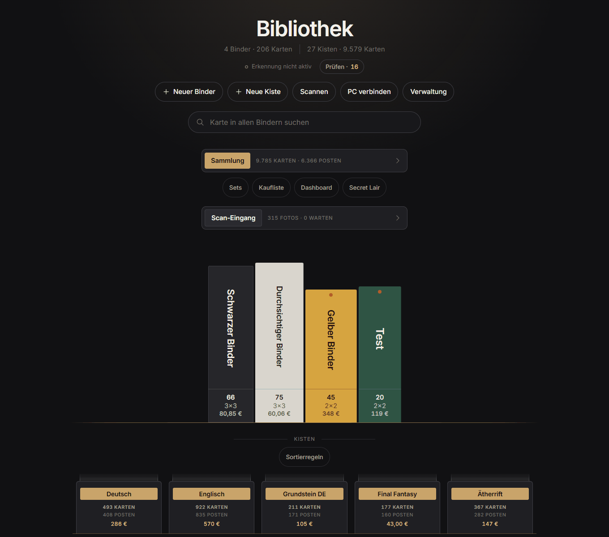
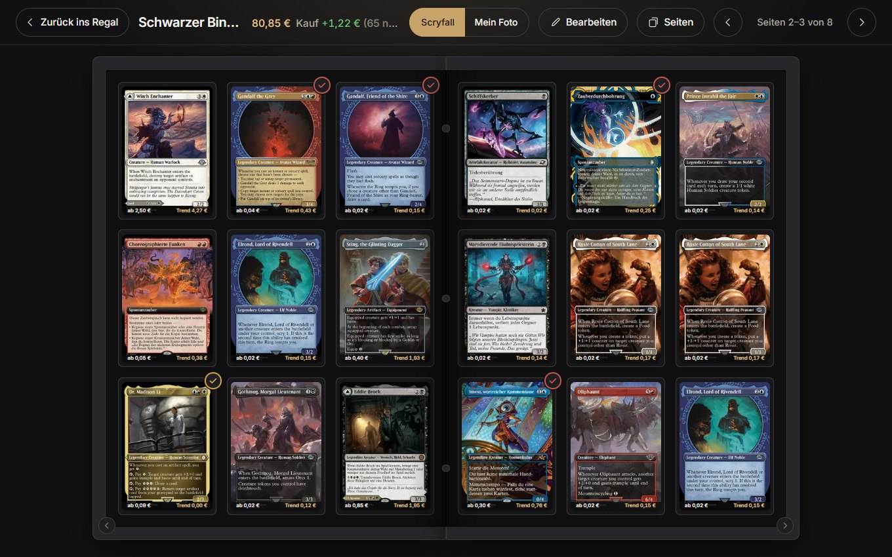
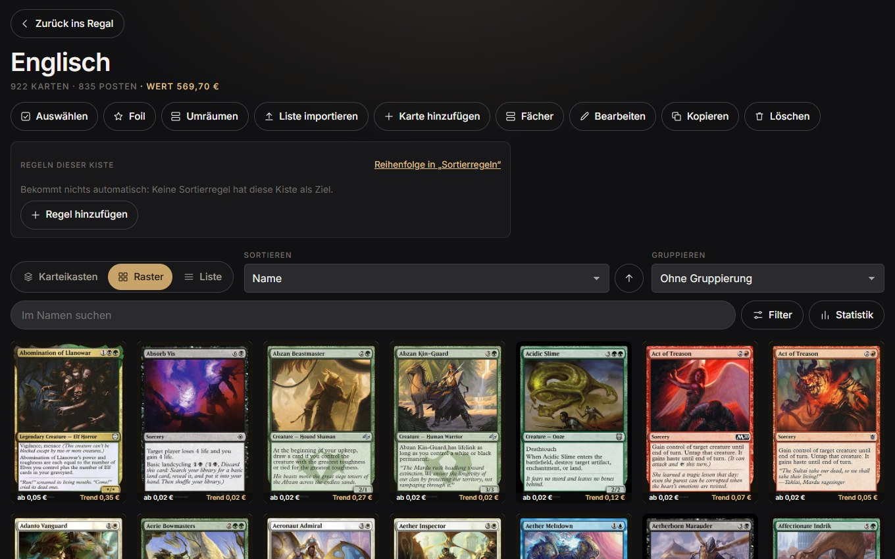
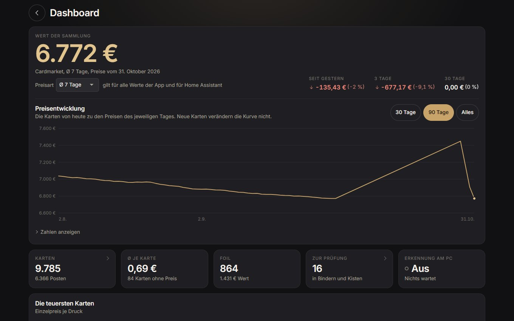
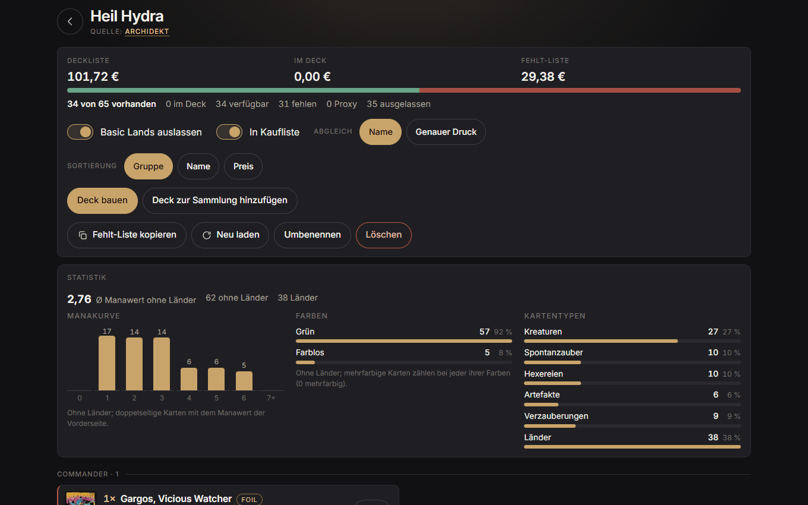
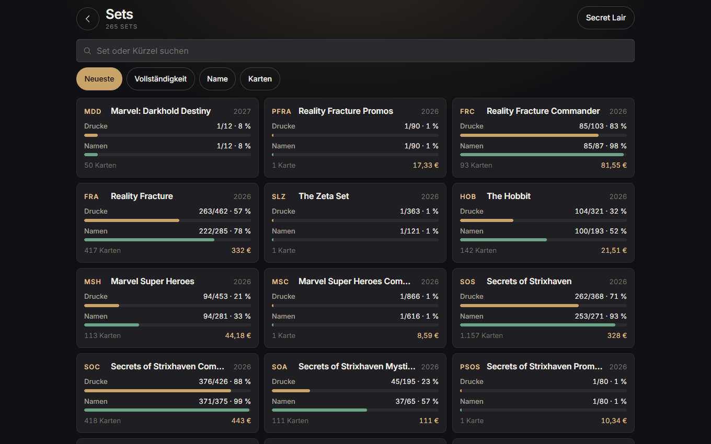
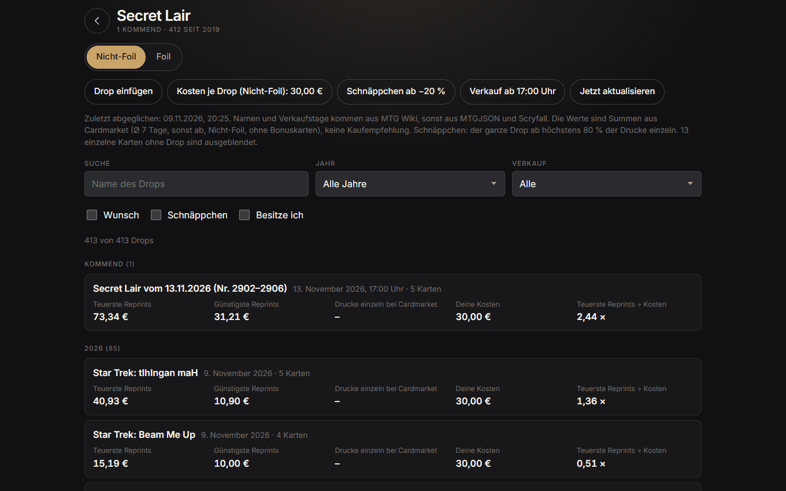
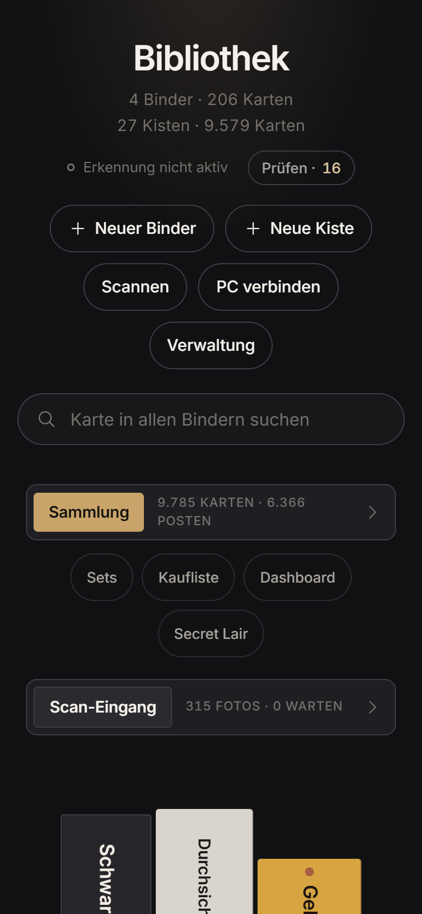
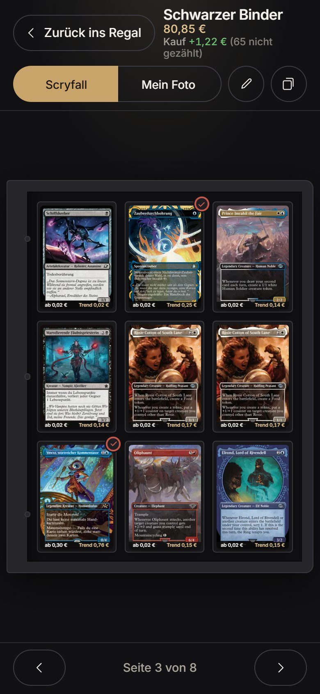

<div align="center">


# MTG Binder für Home Assistant

**Deine Magic-Sammlung als Bücherregal in Home Assistant.<br>
Du fotografierst deine Binderseiten, die App erkennt jede Karte, und du blätterst digital durch deine Binder.**

[![Version][version-shield]][changelog]
![Unterstützt amd64][amd64-shield]
![Oberfläche: Deutsch][sprache-shield]
[![Lizenz: MIT][lizenz-shield]](LICENSE)

[![Repository zu deinem Home Assistant hinzufügen][repo-knopf]][repo-hinzufuegen]

</div>

> **English summary:** A Home Assistant app (add-on) for *Magic: The Gathering* collectors. Photograph your binder
> pages, let a Windows PC with an NVIDIA GPU recognise every card on the photo, and browse the result as a digital
> bookshelf inside Home Assistant, with Cardmarket prices, bulk boxes, sorting rules, decks, Secret Lair tracking and
> proxy printing. The user interface and documentation are **German only**.



## Über die App

MTG Binder bringt deine Magic-Sammlung in Home Assistant. Du fotografierst die Seiten deiner Binder mit dem Handy,
und die App erkennt jede Karte auf dem Foto. Danach stehen deine Binder als Buchrücken in einem digitalen Regal, und
du kannst sie aufschlagen und durchblättern wie die echten. Dazu kommen Kisten für deinen Bulk, tagesaktuelle Preise
von Cardmarket, deine Decks und einiges mehr.

Die App läuft vollständig in deinem eigenen Netzwerk und erscheint im Seitenmenü von Home Assistant. Gedacht ist sie
fürs Smartphone, am PC funktioniert sie aber genauso gut.

Damit das Erkennen schnell geht, teilen sich zwei Programme die Arbeit:

| Teil | Wo es läuft | Was es macht |
|---|---|---|
| **App** (dieses Repository) | in Home Assistant | zeigt deine Sammlung, speichert alles und holt Preise und neue Karten |
| **PC-Erkennung** (Installer im [Release][releases]) | auf einem Windows-PC mit NVIDIA-Grafikkarte | findet und erkennt die Karten auf deinen Fotos |

Deine Fotos warten in der App, bis der PC sie abholt. Ist der PC gerade aus, kannst du trotzdem blättern, suchen,
sortieren und Karten von Hand hinzufügen.

## Was die App kann

### Binder per Foto

Du fotografierst eine Binderseite und lädst das Foto hoch. Die Erkennung findet jede Tasche und bestimmt für jede
Karte den Namen, den Druck und die Sprache. In einem eigenen Test mit Binderseiten lag sie beim Namen immer richtig
und beim Druck in 99,1 % der Fälle. Ist sie sich bei einer Karte nicht sicher, rät sie nicht, sondern legt dir die Karte zur
Prüfung vor.

Jeder Binder steht anschließend mit seiner Farbe, seiner Kartenzahl und seinem Wert im Regal. Auf dem Lesetisch
schlägst du ihn auf und blätterst durch, am PC als Doppelseite und am Handy mit einem Wisch. Dabei kannst du
jederzeit zwischen dem Scryfall-Bild und deinem eigenen Foto umschalten. Wenn du im echten Binder etwas umsteckst,
ziehst du das in der App mit wenigen Tipps nach: Du kannst Karten tauschen, in leere Taschen legen, Leerseiten
einfügen, Seiten löschen und Karten als Foil markieren.

### Kisten und Gesamtsammlung

Für alles, was nicht im Binder steckt, gibt es Kisten. Du kannst sie als Karteikasten, als Raster oder als Liste
ansehen und ganz nach Wunsch sortieren, gruppieren und filtern, auch wenn mehrere tausend Karten darin liegen. Mit
Fächern und Trennkarten bildest du die Aufteilung deiner echten Kisten nach.

Die Gesamtsammlung zeigt alle Karten aus Bindern, Kisten und Decks an einem Ort, und die Suche verrät dir, wo eine
Karte liegt. In der Set-Übersicht siehst du, wie vollständig jedes Set ist und welche Karten dir noch fehlen, auf
Wunsch gleich mit Preis und als Liste zum Kopieren. Karten, von denen du mehr besitzt, als du brauchst, findest du
unter „Überzählige“ und kannst sie als Verkaufsliste herausgeben. Eine bestehende Sammlung aus ManaBox übernimmst du
einfach per CSV-Import.

### Bulk-Scan

Große Mengen scannst du in einem Rutsch. Dazu hängst du dein Handy über einen Kartenauswurf wie den Card Slinger und
wirfst die Karten nacheinander ein. Die App merkt selbst, wann eine Karte still liegt, macht das Foto und zeigt dir
meist schon nach ein bis zwei Sekunden den Namen. Vorher kannst du festlegen, dass alle Karten Foil sind oder aus
bestimmten Sets stammen. So findet die App zuverlässiger den richtigen Druck. Sicher erkannte Karten landen im
Scan-Eingang, alle anderen warten in der Prüfansicht auf dich.

### Sortierregeln

Mit Sortierregeln bestimmst du, welche Karte in welche Kiste gehört, zum Beispiel „alles ab 5 € in die Kiste
Spezial“ oder „rote Karten in die Kiste Rot“. Als Bedingungen stehen dir Farbe, Farbidentität, Manawert, Typ,
Seltenheit, Set, Sonderdrucke, Foil, Sprache, Name und Preis zur Verfügung, außerdem ein Limit je Karte.

Nach dem Scannen räumt die App die Karten von selbst ein und zeigt dir zu jeder Karte Kiste und Fach, damit du den
echten Stapel genauso sortieren kannst. Jedes Einräumen lässt sich zurücknehmen. Änderst du deine Regeln später, sagt
dir „Umräumen“, welche Karten jetzt in eine andere Kiste gehören.

### Preise und Dashboard

Die App holt jeden Tag die aktuellen Preise von Cardmarket. Welcher Preis für dich zählt, stellst du selbst ein: Low,
Trend oder der Durchschnitt über 1, 7 oder 30 Tage. Bei Foil-Karten rechnet die App mit dem Foil-Preis. Öffnest du
eine Karte, bringt dich ein Knopf direkt zu genau diesem Druck bei Cardmarket.

Das Dashboard zeigt dir, was deine Sammlung wert ist und wie sich ihr Wert entwickelt hat. Du siehst dort auch, welche
Karten am teuersten sind und welche zuletzt am stärksten gestiegen oder gefallen sind. Wenn du bei deinen Karten den
Kaufpreis einträgst, erfährst du außerdem, ob du im Plus oder im Minus liegst.

### Decks und Kaufliste

Deine Decks holst du per Link von Archidekt in die App oder als Text, zum Beispiel aus dem Export von Moxfield. Die
App vergleicht jede Deckliste mit deiner Sammlung und zeigt dir, welche Karten du schon hast, wo sie liegen und
welche noch fehlen. Schon im Regal steht an jedem Deck, zu wie viel Prozent du es bauen kannst.

Beim Bauen bekommst du eine Liste zum Abhaken, die dir für jede Karte den Fundort nennt. Zerlegst du das Deck später,
wandern die Karten in der App an ihren alten Platz zurück. Eine kleine Statistik zeigt dir Manakurve, Farben und
Kartentypen.

Fehlende Karten kannst du auf die Kaufliste setzen und für jede einen Wunschpreis hinterlegen. Fällt der Preis
darunter, markiert die App die Karte, und ein Knopf bringt dich direkt zum passenden Angebot bei Cardmarket.

### Secret Lair

Für Secret Lairs zeigt die App die kommenden Drops und alle seit 2019. Zu jedem Drop siehst du, was dieselben Karten
in anderen Drucken wert sind und was die Drucke einzeln oder der ganze Drop bei Cardmarket kosten. Deine eigenen Käufe
trägst du mit dem Kaufpreis ein und verfolgst, wie sich ihr Wert entwickelt. Die App liefert dabei nur Zahlen und
keine Kaufempfehlung.

### Proxys drucken

Aus einer Deckliste macht die App ein druckfertiges PDF im A4-Format mit Passermarken für den Schneideplotter. Dafür
nutzt sie [Silhouette Card Maker][scm] von Alan Cha. Du kannst eigene Bilder und eigene Rückseiten verwenden, für
jede Karte den Druck wählen und ausgleichen, wenn dein Drucker Vorder- und Rückseite leicht versetzt druckt. Proxys
sind nur für Casual-Runden und zum Testen gedacht.

### Zu Hause in Home Assistant

Die App erscheint im Seitenmenü von Home Assistant, ist nur für Admins sichtbar und über Nabu Casa auch unterwegs
erreichbar. Wenn du MQTT nutzt, legt sie von selbst Sensoren an, zum Beispiel für den Gesamtwert, die Kartenzahlen,
den Wert jedes Binders und jeder Kiste, die Gewinner und Verlierer der Woche oder neue Secret-Lair-Drops. Daraus
baust du dir Dashboard-Karten und Benachrichtigungen. Beispiele dafür findest du in [HOME-ASSISTANT.md][ha-doku].

Um deine Daten musst du dir wenig Sorgen machen. Die App sichert ihre Datenbank jeden Tag und vor jedem Update, und
eine Sicherung spielst du direkt in der App wieder ein. Zusätzlich steckt die Datenbank in den Backups von Home
Assistant. Jede Änderung landet in einer Historie und lässt sich rückgängig machen. Neue Karten holt die App täglich
von Scryfall, und auch die PC-Erkennung hält sich selbst aktuell.

## Screenshots

| Lesetisch | Kiste |
|---|---|
|  |  |

| Dashboard | Deck |
|---|---|
|  |  |

| Sets | Secret Lair |
|---|---|
|  |  |

<div align="center">

&nbsp;&nbsp;

</div>

## Was du brauchst

- **Home Assistant OS oder Supervised** auf einem Rechner mit `amd64`, zum Beispiel einem Mini-PC. Andere
  Architekturen wie der Raspberry Pi werden im Moment nicht unterstützt.
- **Einen Windows-PC (10 oder 11) mit NVIDIA-Grafikkarte** im selben Netzwerk. Auf ihm läuft die Erkennung, und er
  sollte gut 30 GB Speicher frei haben.
- **Am besten ein Netzlaufwerk** für Fotos und Vorschaubilder, das du in Home Assistant unter Einstellungen → System →
  Speicher eingebunden hast. Zum Ausprobieren geht es auch ohne.
- **Wenn du magst:** den Mosquitto-Broker mit der MQTT-Integration für die Sensoren. Für den Bulk-Scan brauchst du
  außerdem Nabu Casa oder einen anderen HTTPS-Zugang, weil der Browser die Kamera sonst nicht freigibt.

## Installation

1. Füge das Repository zu deinem Home Assistant hinzu. Am einfachsten geht das über diesen Knopf:

   [![Repository zu deinem Home Assistant hinzufügen][repo-knopf]][repo-hinzufuegen]

   Du kannst es auch von Hand eintragen: Geh zu Einstellungen → Apps (früher „Add-ons“) → Store, öffne das Menü oben
   rechts, wähle **Repositories** und trag diese Adresse ein:

   ```text
   https://github.com/JustTheD-lab/MTG-HA
   ```

2. Öffne im Store **„MTG Binder“** und installiere die App. Home Assistant baut sie auf deinem Rechner zusammen, das
   dauert ein paar Minuten.

   [![MTG Binder in deinem Home Assistant öffnen][app-knopf]][app-oeffnen]

3. Trag im Reiter **Konfiguration** den Speicherort ein. Mehr dazu steht im nächsten Abschnitt.
4. Starte die App und schalte **„In der Seitenleiste anzeigen“** ein.
5. Tippe in der App im Regal auf **„PC verbinden“**, erzeuge einen Schlüssel und lade den Installer herunter
   (`MTG-Binder-Setup.exe`, du findest ihn auch unter [Releases][releases]). Starte ihn auf deinem Windows-PC und
   gib die Adresse `http://<IP von Home Assistant>:8099` und den Schlüssel ein. Beim ersten Mal lädt der Installer
   die Kartendaten und Kartenbilder von Scryfall, das dauert einige Stunden. Brichst du ab, macht er beim nächsten
   Start dort weiter.
6. Wähle im Regal **„Neuer Binder“** und lade deine ersten Fotos hoch.

Die ausführliche Anleitung findest du im Reiter **Dokumentation** der App und in [DOCS.md][doku].

## Konfiguration

| Option | Bedeutung |
|---|---|
| `speicherort` | Der Ordner für Fotos und Vorschaubilder, am besten auf einem Netzlaufwerk, zum Beispiel `/share/netzlaufwerk/mtg-binder`. Lässt du das Feld leer, liegt alles auf dem Rechner von Home Assistant. Das eignet sich nur zum Ausprobieren. Die Datenbank bleibt in jedem Fall in der App. |
| `mqtt` | Schickt die Werte als Sensoren „MTG …“ an Home Assistant. Die Option ist von Haus aus eingeschaltet. |

Über den Port **8099** spricht die PC-Erkennung mit der App. Er ist nur fürs Heimnetz gedacht und funktioniert nur
mit dem Schlüssel aus der App. Gib ihn bitte nicht ins Internet frei.

## Aktualisieren

Home Assistant meldet sich von selbst, sobald es eine neue Version gibt. Was sich geändert hat, steht im
[Änderungsprotokoll][changelog]. Beim ersten Start einer neuen Version sichert die App ihre Datenbank, und die
PC-Erkennung holt sich die passende Version danach selbst.

## Gut zu wissen

Die Oberfläche gibt es bisher nur auf Deutsch.

MTG Binder ist ein privates Hobbyprojekt. Es gibt keine Gewähr und keinen Anspruch auf Support, aber Fehler und
Wünsche kannst du gern als [Issue][issues] melden.

Deine Fotos und deine Sammlung bleiben bei dir. Nach außen fragt die App nur öffentliche Daten ab: Karten und Bilder
bei Scryfall, die Preisdatei bei Cardmarket, Secret-Lair-Daten bei MTGJSON und im MTG Wiki, Decklisten bei Archidekt
und Updates bei GitHub.

## Datenquellen und Dank

- Kartendaten und Kartenbilder: [Scryfall](https://scryfall.com)
- Preise: Price Guide von [Cardmarket](https://www.cardmarket.com)
- Decklisten und Secret-Lair-Daten: [Archidekt](https://archidekt.com), [MTGJSON](https://mtgjson.com) und das MTG Wiki
- Proxy-Druck: [Silhouette Card Maker][scm] von Alan Cha (MIT-Lizenz)

MTG Binder steht in keiner Verbindung zu diesen Diensten und wird von ihnen nicht unterstützt.

## Rechtliches

Der Code dieses Repositorys steht unter der [MIT-Lizenz](LICENSE).

MTG Binder is unofficial Fan Content permitted under the Fan Content Policy. Not approved/endorsed by Wizards.
Portions of the materials used are property of Wizards of the Coast. ©Wizards of the Coast LLC.

Magic: The Gathering, die Kartennamen und die Kartenbilder sind Eigentum von Wizards of the Coast und der jeweiligen
Künstler. Die Screenshots zeigen Kartenbilder von Scryfall.

[version-shield]: https://img.shields.io/badge/dynamic/yaml?url=https%3A%2F%2Fraw.githubusercontent.com%2FJustTheD-lab%2FMTG-HA%2Fmain%2Fmtg_binder%2Fconfig.yaml&query=%24.version&label=Version&color=c9a769
[amd64-shield]: https://img.shields.io/badge/amd64-yes-green.svg
[sprache-shield]: https://img.shields.io/badge/Oberfl%C3%A4che-Deutsch-informational.svg
[lizenz-shield]: https://img.shields.io/badge/Lizenz-MIT-blue.svg
[repo-knopf]: https://my.home-assistant.io/badges/supervisor_add_addon_repository.svg
[repo-hinzufuegen]: https://my.home-assistant.io/redirect/supervisor_add_addon_repository/?repository_url=https%3A%2F%2Fgithub.com%2FJustTheD-lab%2FMTG-HA
[app-knopf]: https://my.home-assistant.io/badges/supervisor_addon.svg
[app-oeffnen]: https://my.home-assistant.io/redirect/supervisor_addon/?addon=afc106f4_mtg_binder&repository_url=https%3A%2F%2Fgithub.com%2FJustTheD-lab%2FMTG-HA
[changelog]: mtg_binder/CHANGELOG.md
[doku]: mtg_binder/DOCS.md
[ha-doku]: mtg_binder/HOME-ASSISTANT.md
[releases]: https://github.com/JustTheD-lab/MTG-HA/releases/latest
[issues]: https://github.com/JustTheD-lab/MTG-HA/issues
[scm]: https://github.com/Alan-Cha/silhouette-card-maker
